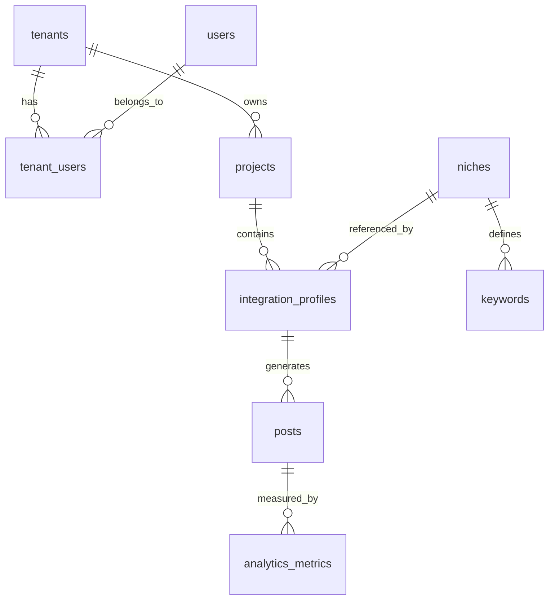
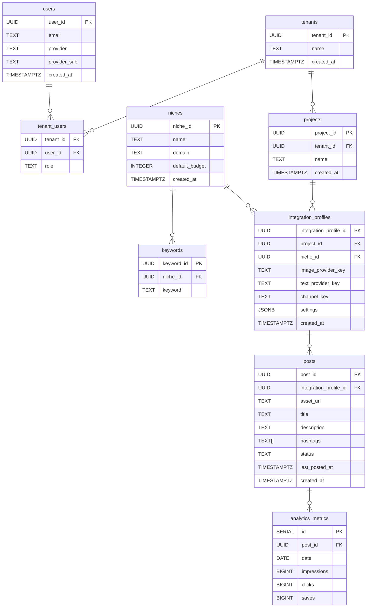

# Content Automation Engine

A modular, multi-tenant platform for AI-driven posts. Phase 1 focuses on Post generation; Phases 2 & 3 add Posting/Ads and Analytics/Pruning.

---

## Data Model

### High-Level Relationships

## Data Objects

- **Tenant** (`identity.tenants`)  
  Represents an isolated customer or organization.

- **User** (`identity.users`)  
  External identity (email + provider) mapped to internal `user_id`.

- **TenantUser** (`identity.tenant_users`)  
  Links a user to a tenant with a specific role (`admin`, `editor`, `viewer`).

- **Project** (`identity.projects`)  
  A workspace under a tenant, grouping integration profiles and posts.

- **Niche** (`niches.niches`)  
  A topical domain (name + domain) with a default budget for content.

- **Keyword** (`niches.keywords`)  
  Individual search terms associated with a niche.

- **IntegrationProfile** (`integration_profiles`)  
  Bundles one niche + one image/model provider + one channel + settings.

- **Post** (`posts.posts`)  
  A generated asset/text item tied to an integration profile and channel.

- **Metric** (`analytics.metrics`)  
  Daily performance data (impressions, clicks, saves) for each post.

### Data Object Tables & Columns

---

## Getting Started

1. **Download and install Docker Desktop**
    Visit Docker (website)[https://www.docker.com/products/docker-desktop/]
    
2. **Build & run services**  
    Build & run entire application: 
    docker compose --env-file ./config/dev/variables.env up --build -d

    Spin up a single service:
    docker compose --env-file ./config/dev/variables.env up --build -d service_name

    Tear down including volumes
    docker compose --env-file ./config/dev/variables.env down -v

    Tear down while keeping persisted volumes as the same
    docker compose --env-file ./config/dev/variables.env down

3. **See db/init/05-seed-db.sql for sample data**  
  
---

## Important Notes
These are the services in order of dependency. This sequence is important when needing to start a dev container
This should be kept up to date as new containers/services are added and removed
  docker compose --env-file ./config/dev/variables.env up --build -d --no-deps db
  docker compose --env-file ./config/dev/variables.env up --build -d --no-deps redis
  docker compose --env-file ./config/dev/variables.env up --build -d --no-deps post-worker
  docker compose --env-file ./config/dev/variables.env up --build -d --no-deps post-dispatcher
  docker compose --env-file ./config/dev/variables.env up --build -d --no-deps post-generation-scheduler

---

## Next Steps

- Phase 2: Poster & AdAutomation workers  
- Phase 3: Analytics Capture & Pruner  
- Drop-in new channel by adding a plugin and an `integration_profile` row  
