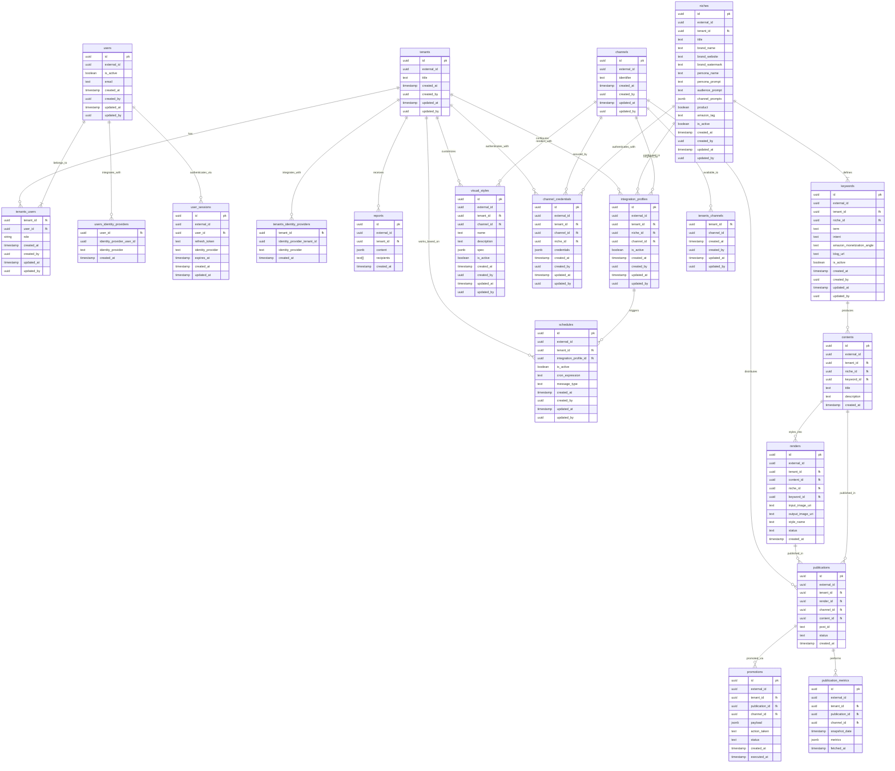

# Content Automation Engine

A modular, multi-tenant platform for AI-driven publications to distribution channel

See system diagram for full context of system design. [Doc](./doc_assets/system-diagram.png)

## Dev Onboarding

The following applications are requirements
- (VS Code)[https://code.visualstudio.com/download]
- (Docker Desktop)[https://docs.docker.com/desktop/#next-steps]
- (Microsoft Azure Storage Explorer)[https://azure.microsoft.com/en-us/products/storage/storage-explorer#Download-4]
- Git e.g. (GitHub Desktop)[https://github.com/apps/desktop]

Install Recommended Extensions when VS Code opens

## Onboarding a Tenant

A tenant is configured via a folder under `config/tenants/<tenant-name>/`. The seed worker reads this structure on startup. When onboarding a new tenant, create the following files and folders (remove items marked *optional* if not needed):

```
config/tenants/<tenant-name>/
  tenant.json                          # required — { "title": "My Tenant" }
  schedules.json                       # optional — array of schedule definitions
  styles/                              # optional — visual styles per channel
    <channel>/
      <style-name>.json
  niches/
    <niche-name>/
      <niche-name>.json                # required — niche config (title, keywords, prompts, etc.)
      prompts/                         # optional — prompt text files referenced from niche JSON
        persona.txt
        ...
      credentials/                     # required — channel credentials per niche (gitignored)
        wordpress.json                 #   { "channel": "wordpress", "site_url": "", "username": "", "app_password": "" }
        pinterest.json                 #   { "channel": "pinterest", "app_id": "", "app_secret": "" }
        wp-app-password.txt            #   optional secret file — overrides app_password in JSON
      seed-images/                     # optional — seed images uploaded to blob storage
        <keyword>/
          img1.png
```

**Credentials are gitignored** (`**/credentials/` and `**/wp-app-password.txt` in `.gitignore`). Populate them locally or via CI secrets.

## Onboarding a Niche and Keywords
The Niche API can be used to add a net new Niche or to add a keyword to a niche

Once it has been onboarded then a folder with the UUID must be made in the blob storage and images to be used uploaded there.

When making a publication to a channel, this structure is expected to be inplace for a given keyword. If UUID changes then a renaming of folders in blob storage must occur. The keyword_name2.txt file just keeps the human-readable keyword name to aid in cases where UUID changes and a mapping needs to be reestablished.

images/
  keywords/
    keyword_uuid_1/
      keyword_name1.txt
      img1.png
      img2.png
    keyword_uuid_2/
      keyword_name2.txt
      img1.png
      img2.png
      img3.png

## Getting Started For Local Development

1. **Download and install Docker Desktop**
    Visit Docker (website)[https://www.docker.com/products/docker-desktop/]

2. **Ensure the following API keys / secrets are in place under <<APP ROOT>>/secrets**
    azure-foundry-proj-default-api-key.txt
    openai-api-key.txt

3. Run "make setup" at project root
4. Open VSCode
5. Edit as needed
6. Run "make local" for full builds. Rest of commands are found in Makefile
7. **See db/init/05-seed-db.sql for sample data**

## Azure Container Apps Deployment

The project deploys to Azure Container Apps via Bicep (IaC). All infrastructure definitions live in `infra/azure/`.

### Prerequisites

- [Azure CLI](https://learn.microsoft.com/en-us/cli/azure/install-azure-cli) installed
- Docker Desktop running
- `psql` client installed (for DB init)
- An Azure subscription with permission to create resources

### First-Time Deployment

```bash
# 1. Login and set subscription
az login
az account set --subscription <your-subscription-id>

# 2. Install Bicep CLI
az bicep install

# 3. Deploy all infrastructure (RG, ACR, PostgreSQL, Redis, Storage, Key Vault, Container Apps)
export POSTGRES_ADMIN_PASSWORD='<choose-a-strong-password>'
make az-deploy

# 4. Set secrets not auto-generated by Bicep (Foundry key + endpoint are auto-populated)
KV="content-engine-dev-kv"
az keyvault secret set --vault-name $KV --name openai-api-key --value "<your-key>"
az keyvault secret set --vault-name $KV --name pinterest-app-id --value "<your-app-id>"
az keyvault secret set --vault-name $KV --name pinterest-app-secret --value "<your-secret>"
az keyvault secret set --vault-name $KV --name refresh-token-encryption-key --value "$(openssl rand -hex 32)"

# 5. Create Entra app registration (one-time)
make az-setup-entra

# 6. Init database schema (one-time)
make az-init-db

# 7. Trigger seed worker
make az-seed

# 8. Verify
make az-status
```

### Subsequent Deploys (code changes)

```bash
make az-build-push    # Rebuild Docker images and push to ACR
make az-deploy        # Update container apps to use new images
```

### Dry Run (preview what Bicep will create)

```bash
az deployment sub what-if \
  --location canadacentral \
  --parameters infra/azure/parameters/dev.bicepparam \
  --parameters postgresAdminPassword='<password>'
```

### Makefile Targets

| Target | Description |
|---|---|
| `make az-setup-entra` | Create Azure Entra app registration (run once) |
| `make az-deploy` | Deploy/update all Azure infrastructure |
| `make az-init-db` | Run DB init scripts against Azure PostgreSQL |
| `make az-build-push` | Build all Docker images and push to ACR |
| `make az-seed` | Trigger seed-worker job |
| `make az-status` | Show Container App status |
| `make az-logs` | Tail logs from Container Apps |
| `make az-destroy` | Delete resource group (removes everything) |

### Infrastructure Overview

All resources are created in `canadacentral` under resource group `rg-content-engine-dev`:

| Resource | SKU | Purpose |
|---|---|---|
| Container Registry | Basic | Docker image storage |
| PostgreSQL Flexible Server | Burstable B1ms | Application database |
| Azure Cache for Redis | Basic C0 | Message broker (TLS on port 6380) |
| Storage Account | Standard_LRS | Blob storage for images |
| AI Foundry (OpenAI) | S0 | LLM provider (gpt-4o, gpt-4o-mini) |
| Key Vault | Standard | Secret management |
| Container Apps Environment | Consumption | Serverless container hosting |

To change region, SKU, or project name, edit `infra/azure/parameters/dev.bicepparam`. For staging/prod, create additional `.bicepparam` files.

### Tear Down

```bash
make az-destroy    # Deletes the entire resource group and all resources within it
```

## Testing

The project uses pytest with containerized dependencies for isolated test execution. Any file that matches *_test.py in repo is considered a test however structurally all tests live under ./test directory

### Running Tests

```bash
# Run all tests
docker compose --env-file ./config/dev/variables.env --profile test run --rm test-runner

# Run specific test file
docker compose --env-file ./config/dev/variables.env --profile test run --rm test-runner pytest test/common/db_core/models/user_test.py -v

# Rebuild test container after dependency changes
docker compose --env-file ./config/dev/variables.env --profile test build test-runner
```

### Test Architecture

- **Test fixtures**: `test/conftest.py` - Uses testcontainers to spin up isolated PostgreSQL instances
- **Test dependencies**: `test/requirements.txt` - Isolated from service dependencies
- **Test container**: `test/Dockerfile` - Self-contained test environment

The test runner has access to:
- All common modules (db_core, providers, etc.)
- Docker socket for testcontainers

## Debugging and Dev Containers
### Steps
1.	Define a devcontainer.json which defines how that container will be spun up. The route our project is going with is by using the service’s Dockerfile directly so that means any special configurations done in the project root docker-compose needs to be replicated e.g. environment variables, networks (a1) . Also ensure any env file is also included and dependent packages are loaded
2.	The service being ran in dev container is ran separate to other so this means the developer at this moment has to manually start up services in the right order as seen in Dependency Order below
```bash
# These are the services in order of dependency. This sequence is important when needing to start a dev container
# This should be kept up to date as new containers/services are added and removed
  docker compose --env-file ./config/dev/variables.env up --build -d --no-deps db
  docker compose --env-file ./config/dev/variables.env up --build -d --no-deps redis
  docker compose --env-file ./config/dev/variables.env up --build -d --no-deps content-generation-worker
  docker compose --env-file ./config/dev/variables.env up --build -d --no-deps content-generation-dispatcher
  docker compose --env-file ./config/dev/variables.env up --build -d --no-deps content-generation-scheduler
```
3.	Ensure Dev Containers extension is installed
4.	Startup containers in right order via terminal and “Reopen in container” for the container you want to debug. YOU CAN TYPE ">Dev Containers:Reopen In Container" in VS Code
5.	Start Python Debugger via the following command
```bash
PYTHONPATH=/app/services/content-generation-worker/app:/app/common:/app python -Xfrozen_modules=off -m debugpy --listen 0.0.0.0:5678 --wait-for-client -m content_generation_worker.app
```
6.	Run -> Start Debugging : if launch.json file is not already in place then select Python Debugger -> Remote Attach -> localhost -> 5678 (or what ever is configured in devcontainer.json)
7.	Happy Debugging!


*a1 On the note of networks, my early research shows that in its simplest form you can only connect to one network without extra steps so I made a special development network for ease of local development*

### Tracking Logs On Local

Once docker containers are running you can track logs by running
```bash
make logs
```

## Assumptions made
1.  Channel is being passed into common/providers/text/azure_foundry.py generate_text method which is the implementation of the interface but we don't use it as of yet.The system messages was tailored to be Pinterest centric. This can be decoupled at a later time if expansion to other channels is desired. **Currently, Pinterest is the only supported channel**

2. This system supports text and images only. There is no support of video in the rendering layer

3. There is multiple locales support but

4. **Keyword `intent` and `amazon_monetization_angle` are only supported in the WP-Uploader workflow.** These fields are appended to the LLM user message and the WordPress channel prompt contains rules to adapt content structure accordingly.
   The Pin-Maker workflow and Pinterest prompts do not use these fields — Pinterest pins are short-form content where intent-based adaptation is not applicable.

## Data Model

### Entity Relationship Diagram


